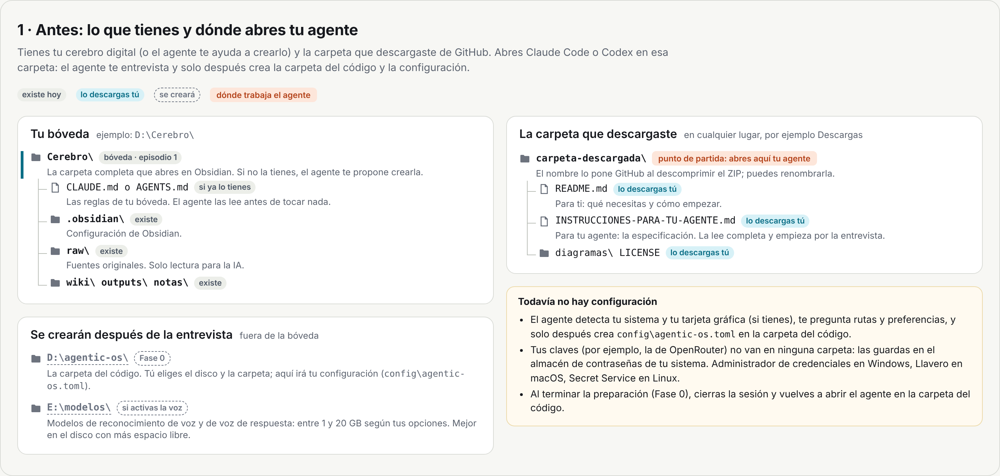
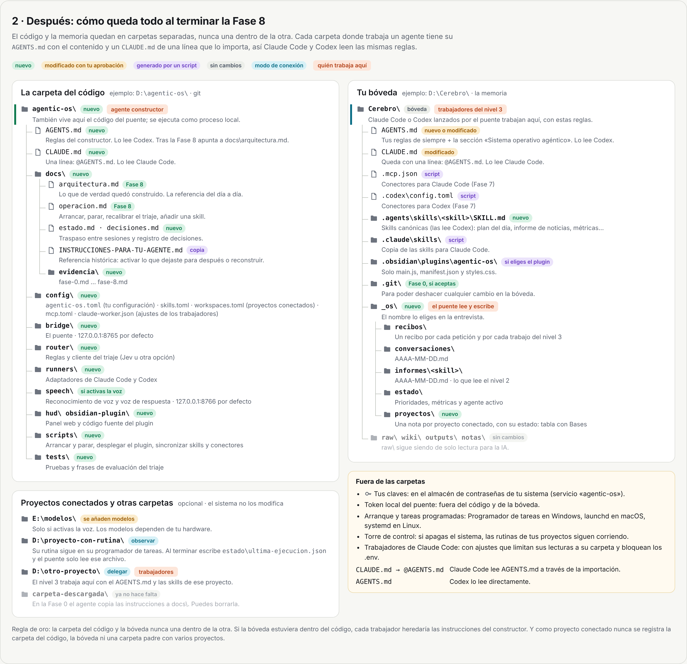

# Tu sistema operativo agéntico

Documentos del vídeo **«Cómo crear tu sistema operativo agéntico (Obsidian + Claude Code + Codex)»** del canal de Arturo Magana-Mora.

**Gratis y sin registro:** no necesitas cuenta de GitHub para leerlos ni para descargarlos.

En el episodio anterior construimos un cerebro digital con Obsidian: [Cómo crear un cerebro digital desde cero](https://www.youtube.com/watch?v=bw8s0opflbk). Con estos documentos lo conviertes en un sistema operativo agéntico:

- Le pides cosas **con un clic o con la voz**, desde Obsidian o desde un panel en el navegador.
- Un **triaje** decide qué tan difícil es cada petición:
  - **nivel 1:** se contesta al instante con lo que ya tienes guardado;
  - **nivel 2:** un modelo pequeño lo resume;
  - **nivel 3:** Claude Code o Codex hacen el trabajo en segundo plano.
- Todo queda guardado en tu cerebro digital, con un recibo de cada petición.
- Si ya tienes otros proyectos, los ves y los lanzas desde el mismo panel. El sistema es la **torre de control** y tus proyectos son los aviones (más abajo).

## Qué hay aquí

| Archivo                           | Para quién                                                                        |
| --------------------------------- | --------------------------------------------------------------------------------- |
| `README.md`                       | Para ti: qué necesitas y cómo empezar (lo que estás leyendo)                      |
| `INSTRUCCIONES-PARA-TU-AGENTE.md` | Para tu agente (Claude Code o Codex): la especificación para construir el sistema |
| `diagramas/`                      | Cómo quedan tus carpetas antes y después                                          |
| `LICENSE`                         | La licencia (MIT)                                                                 |

## Qué necesitas

- **Una computadora con Windows, macOS o Linux.** No hace falta tarjeta gráfica: si no tienes, el agente te propone opciones que funcionan sin ella o en la nube.
- **Claude Code o Codex** (o los dos), con tu cuenta.
- **Obsidian**, si quieres el plugin. También puedes usar solo el panel en el navegador.
- **Opcional:** una cuenta de **OpenRouter** con algo de saldo para el triaje con Jev y para el modelo del nivel 2. Si no quieres cuentas extra, el agente te ofrece un triaje solo con reglas o con un modelo local.
- **Opcional:** micrófono y altavoces, si quieres hablarle.

No necesitas saber programar. Necesitas paciencia: el sistema se construye por fases y el agente se detiene al final de cada una para que revises y apruebes.

## Cómo empezar

1. **Descarga esta carpeta.** En esta página, arriba de la lista de archivos, haz clic en el botón verde **Code** y después en **Download ZIP**. Descomprime el ZIP donde quieras: el agente te va a preguntar después dónde instalar el sistema. Si ya usas git, también puedes clonar el repositorio.

2. **Abre tu agente en la carpeta que descomprimiste.**

   - Claude Code: en la aplicación de Claude, sección **Code**, eliges la carpeta; o en una terminal, entras a la carpeta y escribes `claude`.
   - Codex: en la aplicación, eliges la carpeta como proyecto; o en una terminal, entras a la carpeta y escribes `codex`.

3. **Pega esta instrucción:**

   ```text
   Lee INSTRUCCIONES-PARA-TU-AGENTE.md completo y sigue sus reglas.
   Empieza por la detección y las preguntas de la sección 3. No crees ni instales nada
   hasta que yo confirme el resumen de mi configuración.
   ```

4. **Contesta sus preguntas.** Te va a preguntar, entre otras cosas:

   - dónde está tu cerebro digital (o dónde crearlo);
   - en qué disco y carpeta instalar el sistema;
   - dónde guardar los modelos;
   - qué agentes tienes;
   - si quieres voz y en qué idioma.

   Siempre te propone un valor por defecto y te explica por qué.

5. **Aprueba fase por fase.** Al terminar la preparación te pedirá que abras tu agente en la carpeta nueva del sistema. A partir de ahí, cada sesión empieza leyendo el estado guardado, así que puedes continuar otro día o cambiar de Claude a Codex sin perder el hilo.

## Cómo quedan tus carpetas

Los diagramas usan rutas de ejemplo de Windows. En macOS o Linux la estructura es la misma, con rutas como `/Users/tu-nombre/…` o `/home/tu-nombre/…`. Las rutas reales las eliges tú en la entrevista.

**Antes:** tu cerebro digital y la carpeta que descargaste. Abres tu agente en esa carpeta y, después de la entrevista, crea la carpeta del código.



**Después de la Fase 8:** el código y la memoria quedan en carpetas separadas. Cada carpeta donde trabaja un agente tiene un `AGENTS.md` con las reglas y un `CLAUDE.md` de una línea que lo importa, así Claude Code y Codex leen las mismas reglas.



## ¿Y los proyectos que ya tienes? La torre de control

Si ya tienes proyectos (tu canal, repositorios de código, otros agentes, rutinas que corren cada día), no tienes que meterlos dentro del sistema.

Piénsalo como un aeropuerto. Cada proyecto es un avión que vuela solo, con su propia tripulación: su código, sus instrucciones, sus skills y su programador de tareas. El sistema es la torre de control: ve dónde está cada avión, le da instrucciones y anota todo, pero no lo pilota.

**La prueba:** si apagas el sistema, tus rutinas siguen corriendo.

Cada proyecto se conecta en uno o varios de estos modos:

| Modo         | Qué hace                                                                                                                                                           | ¿Usa IA? |
| ------------ | ------------------------------------------------------------------------------------------------------------------------------------------------------------------ | -------- |
| **Observar** | Tu proyecto escribe un archivo pequeño con la hora y si salió bien. El sistema solo lee ese archivo y te muestra una tarjeta: verde, roja, o amarilla si no corrió | No       |
| **Ejecutar** | Un botón que corre un comando de tu proyecto                                                                                                                       | No       |
| **Delegar**  | Claude Code o Codex trabajan dentro de tu proyecto, con sus propias instrucciones y sus propias skills                                                             | Sí       |

**Ejemplo:** una rutina diaria que ya corre con el programador de tareas. No la mueves. Al terminar, escribe su archivo de estado, y el panel te avisa el mismo día si no corrió.

En el panel aparece una sección «Proyectos». En Obsidian, cada proyecto tiene su nota, y con Bases las ves todas como una tabla.

El agente te pregunta qué proyectos conectar y en qué modo; todo es opcional. Tres reglas:

- conecta proyecto por proyecto, nunca la carpeta que los contiene a todos;
- nunca conectes la carpeta del código del propio sistema;
- si un proyecto maneja dinero o claves, conéctalo solo para observar.

## Antes de empezar, tres advertencias

1. **El nivel 3 actúa.** Un agente con acceso a tu correo o tu calendario puede enviar o cambiar cosas. El sistema pide tu confirmación para todo lo que sale de tu computadora. No lo desactives, y nunca uses los modos de tu agente que saltan todos los permisos.
2. **Costes.** El triaje con Jev cuesta céntimos. El nivel 2 cobra por uso. El nivel 3 consume el límite de tu suscripción de Claude o de Codex. Pon un límite de gasto a tu clave de OpenRouter.
3. **Privacidad.** Si el reconocimiento de voz es local, tu voz no sale de tu computadora. Pero la frase que dices va al servicio de triaje, el nivel 2 manda a la nube lo que resume y el nivel 3 lee tu cerebro digital. Lo sensible, en una bóveda aparte.

**Tus claves** (por ejemplo, la de OpenRouter) **nunca se las des al agente en el chat.** Él te explica cómo guardarlas en el almacén de contraseñas de tu sistema, y el programa las lee cuando las necesita.

## Preguntas frecuentes

**¿Necesito cuenta de GitHub?** No. Para leer y descargar estos documentos no hace falta. Solo la necesitas si quieres abrir un *issue* para reportar un error.

**¿Necesito una tarjeta NVIDIA?** No. Con NVIDIA puedes tener la voz en local con más opciones; en una Mac con Apple Silicon o en una computadora sin tarjeta gráfica hay alternativas ligeras o en la nube. El agente las elige contigo según tu hardware.

**¿Y si no tengo el cerebro digital del episodio anterior?** El agente te ofrece crear la estructura básica (`raw`, `wiki`, `outputs` y `notas`). Te recomiendo ver primero ese vídeo para entender por qué está organizado así.

**¿Puedo usar Claude Code y Codex a la vez?** Sí. El sistema guarda las instrucciones en un formato que leen los dos, y desde el panel cambias cuál trabaja.

**¿Tengo que usar la voz?** No. Puedes dejarla para más tarde o no usarla nunca; los botones y el texto funcionan igual.

**¿Necesito `INSTRUCCIONES-PARA-TU-AGENTE.md` cuando el sistema ya funciona?** No para usarlo. Es el documento de construcción: durante las fases el agente lo consulta en cada sesión, y al terminar escribe `docs/arquitectura.md` con lo que de verdad quedó construido, que pasa a ser su referencia. En la Fase 0 el agente guarda una copia en la carpeta del sistema: sirve para activar algo que dejaste para después, como la voz, o para reconstruir el sistema en otra computadora.

**¿Puedo borrar la carpeta que descargué?** Sí, cuando termine la Fase 0, porque el agente ya copió las instrucciones a `docs/` en la carpeta del sistema.

**¿El sistema puede leer mis otros proyectos?** Solo trabaja en los que conectes, uno por uno, y no escribe fuera de su carpeta sin permiso. Pero hay que decirlo correctamente: en Windows, estos agentes pueden leer archivos fuera de su carpeta con comandos sencillos. Por eso el agente configura a los trabajadores para que no lean fuera de su carpeta ni archivos `.env`, en lo que la herramienta permite, y por eso tus claves van en el almacén de contraseñas y no en archivos de texto.

**¿Las skills de cada proyecto siguen funcionando?** Sí. Cuando el sistema delega en un proyecto, el agente usa las skills de ese proyecto y las de tu usuario. Las skills de un proyecto no aparecen en otro. Lo que guardes a nivel de usuario (por ejemplo, en `%USERPROFILE%\.claude\skills` en Windows) entra en todos los trabajos, así que deja ahí solo lo genérico.

**¿Qué es la «bóveda»?** La carpeta completa de tu cerebro digital, la que abres en Obsidian, con todas sus subcarpetas (`raw`, `wiki`, `outputs`, `notas`…). `raw` es solo una de ellas.

**¿Funciona en otros idiomas?** Sí. El agente te pregunta el idioma y el acento, y elige las voces y el reconocimiento de voz según eso.

**Algo falló o el agente se atascó.** Pídele que lea `docs/estado.md` y `docs/decisiones.md` en la carpeta del sistema y que te explique en qué fase va y qué falta.

## Créditos y licencia

- La arquitectura se inspira en el command center con Claude Code y Obsidian que publicó Chase AI: <https://www.chaseai.io/blog/claude-code-obsidian-command-center>.
- Licencia **MIT** (archivo `LICENSE`): puedes usar, copiar, modificar y compartir estos documentos, también en proyectos comerciales, siempre que conserves el aviso de copyright y la licencia.
- ¿Encontraste un error o algo cambió? Abre un *issue* en este repositorio o déjalo en los comentarios del vídeo.

---

**Versión 1.3 · 2026-10-27.** Estos documentos reflejan herramientas y precios de octubre de 2026. Cambian rápido: el agente tiene la instrucción de verificar todo contra la documentación oficial antes de usarlo.
